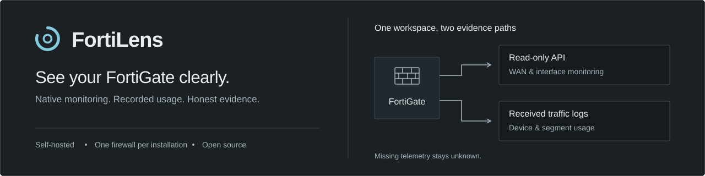
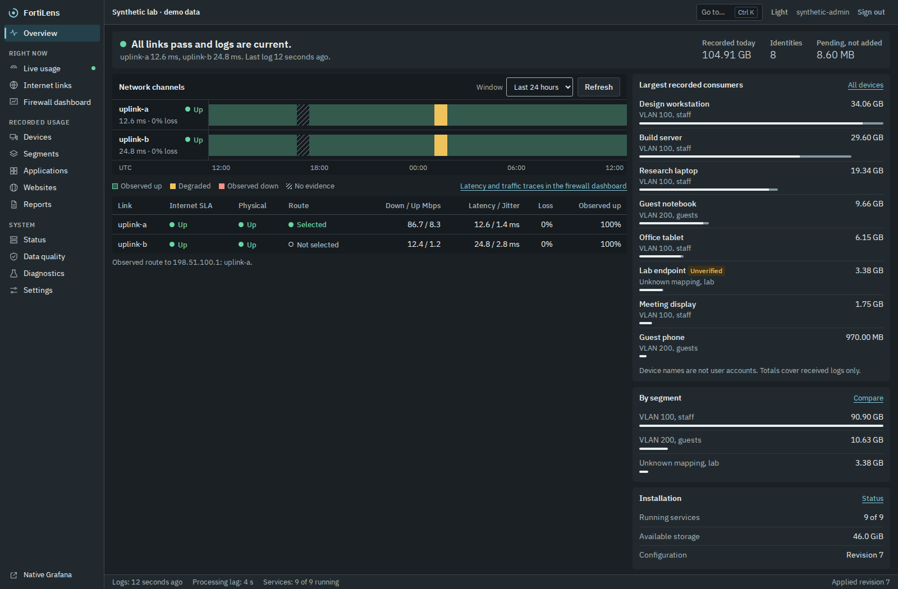
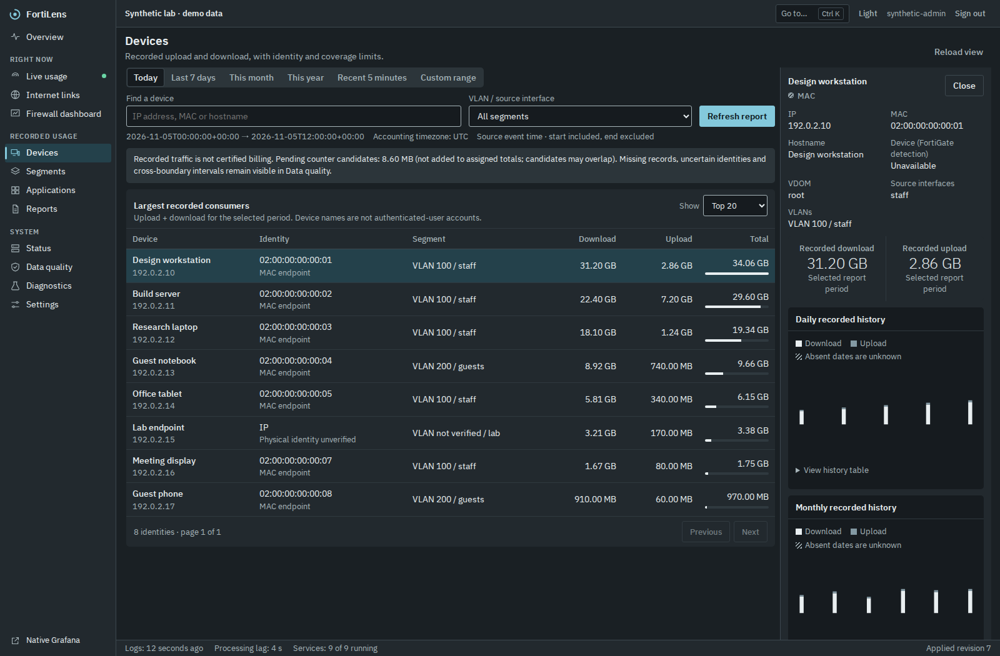
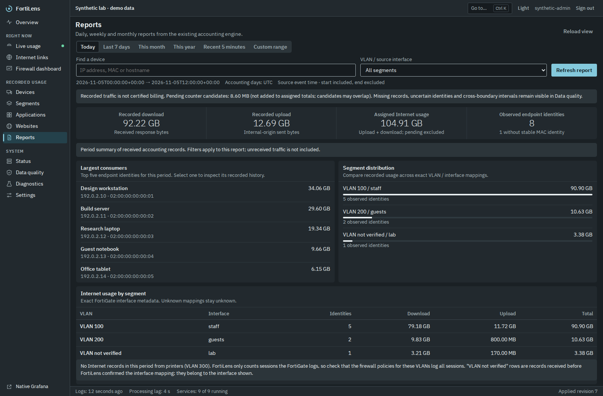
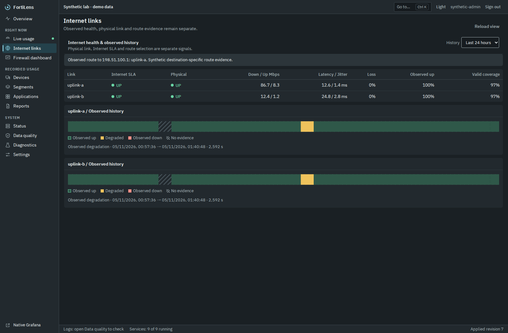
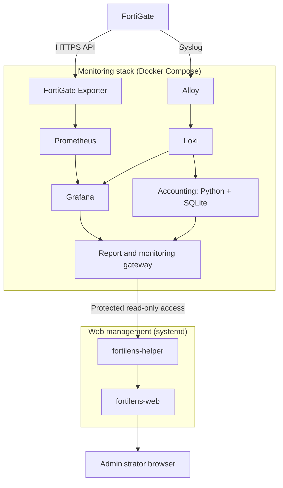

<p align="center">
  
</p>

<p align="center">
  <a href="https://github.com/Rafattitas/fortilens/actions/workflows/ci.yml"></a>
  <a href="LICENSE"></a>
  
  
  
</p>

<p align="center">
  <strong>See link health, recorded usage, and the evidence behind them.</strong><br>
  A self-hosted FortiGate workspace with native Grafana monitoring and guided web setup.
</p>

<p align="center">
  <a href="#install">Install</a> ·
  <a href="docs/README.md">Documentation</a> ·
  <a href="docs/architecture/ARCHITECTURE.md">Architecture</a> ·
  <a href="ROADMAP.md">Roadmap</a> ·
  <a href="CONTRIBUTING.md">Contribute</a>
</p>

<p align="center">
  
  <br><sub>Overview in the shipped interface, rendered with synthetic fixtures. No customer data is shown.</sub>
</p>

## What it answers

FortiLens brings FortiGate metrics and received traffic logs into one workspace on
your own server, with your own credentials and data.

| Your question | Where to look |
|---|---|
| Are my Internet links healthy, and were they healthy earlier? | **Overview** and **Internet** show SLA state, latency, jitter, packet loss, physical state and observed history. |
| Which device used the most, in which direction? | **Usage** searches endpoints and opens each device's daily and monthly history. |
| How much did each VLAN use? | **Segments** compares exact VLAN and interface mappings. |
| What was the total for a period? | **Reports** covers Today, rolling 7 days, this month, recent 5 minutes or a custom range. |
| Can I trust these numbers? | **Evidence** shows collection gaps, pending counters and identity limits. |
| What is happening right now, in detail? | **Live monitoring** opens the native Grafana dashboard. |
| Is the installation itself working? | **System**, **Diagnostics** and **Settings** cover services, collection and reviewed configuration changes. |

Usage figures come from received accounting records. Missing records never become
zero traffic or a confirmed outage, and totals are not complete billing figures.

<details>
<summary>See Usage, Reports and Internet screenshots</summary>



*Usage: endpoint identities, directional totals and device history. Shipped UI with synthetic fixtures.*



*Reports: a period summary drawn from the same accounting evidence as Usage. Shipped UI with synthetic fixtures.*



*Internet: SLA observations, physical state and history with missing evidence marked. Shipped UI with synthetic fixtures.*

</details>

The [screenshot gallery](docs/design/screenshots/README.md) has the remaining views,
themes and narrow layouts.

## Is it a good fit?

**Good fit:** you run one FortiGate per installation, have a Linux server for it, and
want link health and device or VLAN usage without sending data to a third party.

**Not a fit today:**

- Several firewalls in one installation. Use a separate installation for each.
- Security-event analytics, or website and application analytics. These are
  [planned](ROADMAP.md), not shipped.
- Certified billing, or complete traffic capture.
- High availability or multiple writers.
- ARM hosts. Deployed monitoring targets Linux/amd64.

## Install

Both paths need HTTPS access to the FortiGate with a read-only API token, a trusted
certificate or private CA, and forward-traffic syslog configured by the firewall
administrator. FortiLens never changes FortiGate settings.

| | Web setup (recommended) | Portable CLI |
|---|---|---|
| **Gives you** | Browser setup, the full console, reviewed Apply and rollback | Command-line setup; the console is opt-in |
| **Host** | Ubuntu x86-64, Python 3.11+; 24.04+ recommended | Linux x86-64, Python 3.10+ |
| **Also needs** | systemd, Python venv, Docker Engine, Docker Compose v2 | Docker Compose v2 |
| **Available from** | `main` only | `main`, or the v0.2.0 ZIP without the console |
| **Guide** | [Web Setup & Settings](docs/getting-started/WEB_SETUP.md) | [Portable guide](portable/README.md) |

Size resources for your actual traffic and retention; container limits are not a
capacity guarantee.

### Web setup

```bash
git clone https://github.com/Rafattitas/fortilens.git
cd fortilens
sudo ./install.sh
```

Management listens on loopback by default. From your workstation, open a tunnel and
then browse to `http://127.0.0.1:3030`:

```bash
ssh -N -L 3030:127.0.0.1:3030 user@monitoring-server
```

Create your administrator with the one-time installation token, then configure the
connection, WANs, syslog and retention in the browser. Review and Apply starts the
monitoring stack. There is no default password.

**Already running FortiLens?** Do not initialize again. Use `--adopt` with the exact
existing Compose project, as described in the
[web setup guide](docs/getting-started/WEB_SETUP.md).

### Portable CLI

```bash
git clone https://github.com/Rafattitas/fortilens.git
cd fortilens/portable
python3 setup.py init
python3 setup.py start
python3 setup.py doctor
```

The setup utility uses only the Python standard library. For a versioned package,
download [fortilens-v0.2.0.zip](https://github.com/Rafattitas/fortilens/releases/download/v0.2.0/fortilens-v0.2.0.zip)
and [SHA256SUMS.txt](https://github.com/Rafattitas/fortilens/releases/download/v0.2.0/SHA256SUMS.txt),
verify the checksum, and run the same commands from its `forti-monitor/` directory.

The [portable guide](portable/README.md) covers passwords, addresses, FortiGate
logging and daily commands. `doctor` is read-only and never restarts anything.

### Then send logs from the FortiGate

Send forward traffic logs to the monitoring server. The default receiver is
**TCP 1514 / RFC5424**. For an existing native UDP sender, use the explicit
[native UDP profile](docs/operations/SYSLOG_NATIVE_UDP.md).

Keep browser services on loopback behind an SSH tunnel or a reviewed HTTPS proxy.
Credentials must not cross an untrusted plain-HTTP network.

## How it fits together



Arrows show how data reaches you. Accounting and the gateway are optional, and Node
Exporter adds host metrics to Prometheus. Native UDP logs reach Alloy through a managed
receiver, and accounting also reads FortiGate metadata and Prometheus samples.

The web process has no Docker access. Only the helper operates the one registered
Compose project, using fixed commands. The portable CLI generates the same stack
without the two management services. See [architecture](docs/architecture/ARCHITECTURE.md) and
[management architecture](docs/architecture/MANAGEMENT_ARCHITECTURE.md).

## Honest signals, clear limits

- **Missing data stays missing.** Dropdown fallback choices are configuration, not measurements. No SLA series does not establish a WAN outage.
- **SLA selection is explicit.** Review fresh names in the intended VDOM and select the check that represents your Internet-health policy. Blank selection stays supported and requires review; a name such as `google` is a site choice, never a new public default.
- **Collection paths need separate evidence.** Native UDP source filtering is not authentication. Receiver readiness and TCP handoff do not prove Loki storage, complete traffic capture or accurate site totals.
- **Usage means received-log evidence.** Valid zero deltas stay zero; unsafe cumulative candidates stay pending. Stable event identities prevent replay double counting. Missing MACs remain explicitly unverified. [Read the accounting contract](docs/architecture/ACCOUNTING_ENGINE.md).
- **Interface metadata has a scope and time.** VLAN mapping uses exact VDOM/interface keys, never subnets. Current inventory cannot establish an old VLAN assignment. FortiGate settings are never changed automatically.
- **Early access.** Clean Docker installations and controlled HTTPS/syslog fixtures have been tested. Every FortiOS release, ARM, and new real-device onboarding are not yet validated.
- **Current scope.** One FortiGate per installation. Optional alerts are paused candidates; production activation and recipient testing are explicit operator actions. Complete topology discovery and per-flow SD-WAN route attribution are not inferred.

## Also included

- [Optional compact accounting storage](docs/architecture/COMPACT_ACCOUNTING.md): a verified offline copy that reduces ledger size. Never automatic.
- [Optional alert candidates](docs/operations/OPTIONAL_ALERTS.md): paused WAN, performance and collection rules that leave existing notifications alone.
- [Read-only diagnostics](docs/operations/TROUBLESHOOTING.md): tell failed collection, old samples, missing logs and authentication problems apart.
- [Upgrades from v0.1.0](docs/operations/UPGRADE.md): a reviewed migration with hash-guarded rollback.

## Built to be inspectable

The source includes accounting, identity, period, VLAN and WAN tests, a Linux and
Windows Python matrix, and an isolated Docker pipeline. Synthetic traffic checks the
full Alloy → Loki → accounting → Prometheus path, including replay and restart. See
[verification](docs/development/VERIFICATION.md) for the evidence and its real-device limits.

## Contributing

FortiOS compatibility reports, sanitized API fixtures, accounting edge cases and
documentation fixes are especially useful. Read the
[contribution guide](CONTRIBUTING.md) or
[open an issue](https://github.com/Rafattitas/fortilens/issues/new/choose). If
FortiLens helps you, a star makes it easier for other network engineers to find.

## Security and license

Report sensitive findings using [SECURITY.md](SECURITY.md). Keep tokens, production
configurations, raw customer logs and private screenshots out of public issues and
pull requests. FortiLens is distributed under the [MIT license](LICENSE); see the
[third-party notices](THIRD_PARTY_NOTICES.md).

Built by [Rafat Almudarres](https://github.com/Rafattitas).

<sub>Independent community project. Not affiliated with or endorsed by Fortinet. FortiGate and related names belong to their respective owners.</sub>
