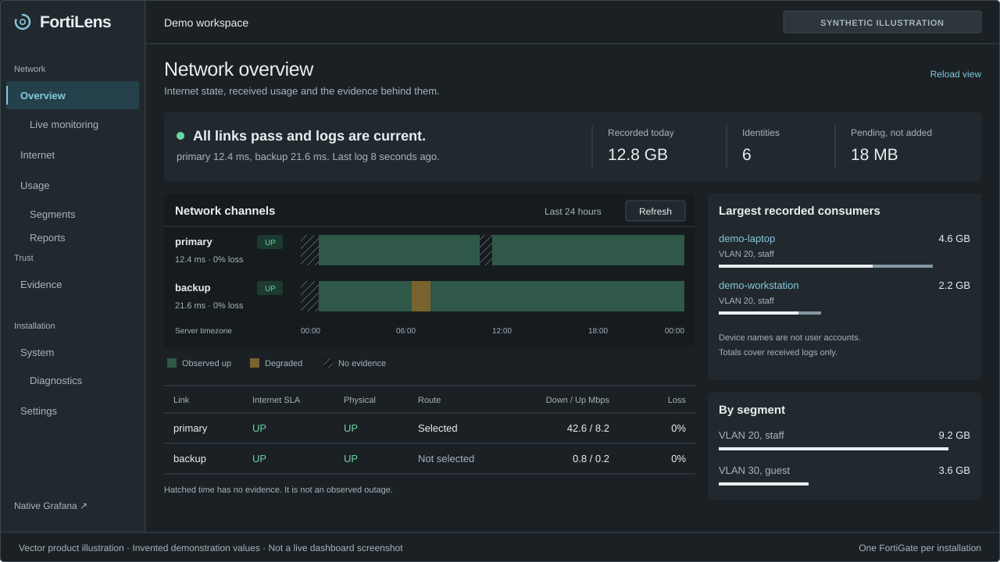
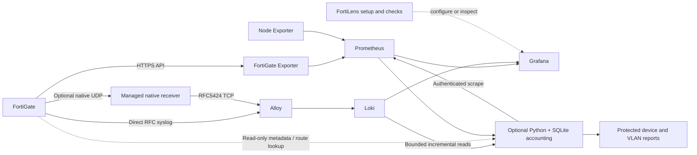

<p align="center">
  
</p>

<p align="center">
  <a href="https://github.com/Rafattitas/fortilens/actions/workflows/ci.yml"></a>
  <a href="LICENSE"></a>
  
  
  
</p>

<p align="center">
  <strong>WAN performance. Device usage. Interface context. One self-hosted view.</strong><br>
  FortiGate observability built around Grafana, Prometheus, Loki, and a guided setup.
</p>

<p align="center">
  <a href="https://github.com/Rafattitas/fortilens/releases/tag/v0.2.0">Portable v0.2.0</a> ·
  <a href="#get-started">Get started</a> ·
  <a href="docs/README.md">Documentation</a> ·
  <a href="docs/ARCHITECTURE.md">Architecture</a> ·
  <a href="ROADMAP.md">Roadmap</a> ·
  <a href="CONTRIBUTING.md">Contribute</a>
</p>

**Choose the right installation:** current source includes Web Setup & Settings
and the unified console. The published v0.2.0 portable ZIP is immutable and
predates those components. See the [release guide](docs/RELEASING.md) for the full
and portable distribution strategy; a prepared archive is not a published release.

| Start here | Guide |
|---|---|
| Install web management or adopt an existing site | [Web Setup & Settings](docs/WEB_SETUP.md) |
| Use the dependency-free CLI | [Portable installation and operations](portable/README.md) |
| Understand usage evidence and limitations | [Accounting contract](docs/ACCOUNTING_ENGINE.md) |
| Troubleshoot missing data | [Read-only diagnostics](docs/TROUBLESHOOTING.md) |
| Receive FortiGate native/default UDP logs | [Managed native UDP profile](docs/SYSLOG_NATIVE_UDP.md) |
| Develop, test or prepare a release | [Contributing](CONTRIBUTING.md), [QA](docs/QA.md), [releases](docs/RELEASING.md) |
| Browse all guides | [Documentation index](docs/README.md) |

## A clearer view of the network you already run

FortiLens brings FortiGate metrics and traffic logs into a practical monitoring stack. Track WAN SLA history, review recorded device usage, inspect VLAN/interface metadata, and find missing collection data without guessing that a quiet interface is down.

Designed for **one FortiGate per independent installation**: your server, your credentials, your data.

<p align="center">
  
  <br><sub>Illustrative overview with synthetic data. Actual panels and readings depend on your FortiGate, permissions, and received samples.</sub>
</p>

## What you get

| Capability | What it does |
|---|---|
| **Web Setup & Settings (current source)** | Independent nonroot management, one-time admin bootstrap, seven-step setup, write-only secrets, revisions, safe Apply/rollback and diagnostics. [Web installation guide](docs/WEB_SETUP.md). |
| **Unified console (current source)** | One FortiLens sign-in and navigation for native Grafana monitoring and persistent reports; opt in with `init --enable-portal`. See the [console guide](docs/UNIFIED_CONSOLE.md). |
| **WAN SLA visibility** | State, latency, jitter, packet loss, observed availability, and sample coverage. |
| **A dashboard that adapts** | Chained FortiGate → VDOM → SLA → WAN selectors, with repeating interface cards. |
| **Persistent device accounting** | Directional upload/download, stable MAC endpoints and explicit unverified fallbacks; replay-safe received-log ledger. |
| **Fixed-period reports** | Today, rolling 7 days, this calendar month, custom ranges, device search, top consumers and daily/monthly history. |
| **VLAN Internet usage** | Exact VDOM/interface/parent/VLAN mapping, segment totals and drilldown; unknown mappings remain unknown. |
| **Trust evidence** | Pending counters, source-wide classifications, processing lag, missing telemetry and observed WAN coverage. |
| **Interface and VLAN review** | Reuses exporter labels, fills metadata gaps through read-only API requests, and asks you to confirm Internet interfaces. |
| **Useful readiness checks** | Distinguishes failed collection, old samples, missing logs, and authentication boundaries. |
| **Safe deployment** | Six base monitoring services, optional constrained accounting/gateway services and an explicit native UDP receiver profile, reviewed configuration changes and preserved dashboards. |
| **Optional alert candidates** | Paused WAN/performance/collection rules; email/Telegram environment references without changing existing notifications. |

## Requirements

| Path | Host and Python | Other prerequisites |
|---|---|---|
| Full web management | Ubuntu x86-64, Python 3.11+; Ubuntu 24.04+ recommended | systemd, Python venv, Docker Engine and Docker Compose v2 |
| Portable CLI | Linux x86-64, Python 3.10+; standard library only | Docker Compose v2 |

Both paths need reachable FortiGate HTTPS/read-only API access, a trusted
certificate or private CA, and forward-traffic syslog configured by the firewall
administrator. Windows supports portable configuration generation and tests;
deployed monitoring targets Linux/amd64. Size resources for actual traffic and
retention, rather than treating container limits as a capacity guarantee.

## Get started

For the supported Ubuntu host above, the current Web Setup & Settings source
provides one-command bootstrap:

```bash
git clone https://github.com/Rafattitas/fortilens.git
cd fortilens
sudo ./install.sh
```

Open management on `http://127.0.0.1:3030` through an SSH tunnel, or install with a
trusted HTTPS certificate for LAN access. Create your own administrator using the
one-time installation token, then configure the connection, WANs, syslog and
retention in the browser. Review and Apply starts the monitoring stack. There is
no default management password. The portal starts independently of Grafana/Loki.

For the default loopback listener, run this on your workstation and open
`http://127.0.0.1:3030` locally:

```bash
ssh -N -L 3030:127.0.0.1:3030 user@monitoring-server
```

See [Web Setup & Settings](docs/WEB_SETUP.md) for prerequisites, HTTPS, explicit
adoption of existing installations and recovery. Web management is included in the
current source; the older published v0.2.0 ZIP remains unchanged. Existing installations must use `--adopt`
with their **exact existing Compose project**, rather than initializing again.

#### Existing portable CLI

You need **Linux x86-64**, **Docker Compose v2**, and **Python 3.10+**. The setup utility uses only the Python standard library. These prerequisites are not installed by FortiLens.

```bash
git clone https://github.com/Rafattitas/fortilens.git
cd fortilens/portable

python3 setup.py init
python3 setup.py start
python3 setup.py doctor
```

Prefer a standalone package? Download [fortilens-v0.2.0.zip](https://github.com/Rafattitas/fortilens/releases/download/v0.2.0/fortilens-v0.2.0.zip) and [SHA256SUMS.txt](https://github.com/Rafattitas/fortilens/releases/download/v0.2.0/SHA256SUMS.txt), verify the checksum, extract the archive, and run the same three Python commands from its `forti-monitor/` directory. The release workflow tests and builds this allowlisted package from the version tag.

During setup, enter your FortiGate address, HTTPS API port, read-only API token, optional private CA, and syslog settings. Review discovered interfaces and explicitly confirm your Internet interfaces. Keep browser services on localhost for an SSH tunnel, or use a reviewed HTTPS reverse proxy for network access. Reporting credentials must not cross an untrusted plain-HTTP network.

Then configure the intended FortiGate syslog destination to send forward traffic logs to your monitoring server. The default receiver is **TCP1514 / RFC5424**. For an existing native/default UDP sender, current source offers the explicit **UDP / fortigate** profile; choose the actual destination port and review [its input and delivery limits](docs/SYSLOG_NATIVE_UDP.md). Existing installations are not converted automatically. API users, permissions, and syslog settings are configured on FortiGate by your administrator; the setup utility does not change them.

Grafana defaults to `http://127.0.0.1:3001/d/forti-monitor`, reached through an SSH tunnel or reviewed HTTPS proxy. Its login is `admin`; the password is in `local/secrets/grafana_admin_password`. When accounting is enabled, protected reports use the configured reporting address (default `http://127.0.0.1:3002/`) and separate password in `local/secrets/usage_admin_password`. Use these reports for fixed-period device/VLAN answers independently of Grafana’s global time range. The unified-console guide explains the source-only opt-in and its native Grafana subpath.

Interactive setup offers accounting explicitly; file-based setup can add `--enable-accounting`. Choose an explicit accounting timezone and expected FortiGate device ID. Review [installation](docs/INSTALLATION.md), [upgrades](docs/UPGRADE.md), [troubleshooting](docs/TROUBLESHOOTING.md), and [optional alerts](docs/OPTIONAL_ALERTS.md).

**Start with the [installation guide](docs/INSTALLATION.md)** for certificates, network access, interface review, and troubleshooting. No shared password or token is shipped.

## Your everyday toolbox

Run these from `portable/`:

```bash
# List SLA names/interfaces from received metrics
python3 setup.py discover

# Review interface type, role, parent, and VLAN ID
python3 setup.py interfaces

# Read existing exporter evidence without a direct device API request
python3 setup.py interfaces --metrics-only

# Machine-readable readiness; no restarts or configuration changes
python3 setup.py doctor --json

# Explicitly add one read-only FortiGate status request
python3 setup.py doctor --api-check
```

Inventory never selects WANs automatically. Missing roles, topology gaps, and conflicting evidence remain **Needs review**. A post-start interface selection creates a backed-up local dashboard candidate for review/import; it preserves edits in the running dashboard.

## How it fits together



Grafana and the protected reports bind to loopback by default; syslog uses its configured receiver address. [Read the architecture notes](docs/ARCHITECTURE.md).

## Honest signals, clear limits

- **Missing data stays missing.** Dropdown fallback choices are configuration, not measurements. No SLA series does not establish a WAN outage.
- **SLA selection is explicit.** Review fresh names in the intended VDOM and select the check that represents your Internet-health policy. Blank selection stays supported and requires review; a name such as `google` is a site choice, never a new public default.
- **Collection paths need separate evidence.** Native UDP source filtering is not authentication. Receiver readiness and TCP handoff do not prove Loki storage, complete traffic capture or accurate site totals.
- **Usage means received-log evidence.** Valid zero deltas stay zero; unsafe cumulative candidates stay pending. Stable event identities prevent replay double counting. Missing MACs remain explicitly unverified. [Read the accounting contract](docs/ACCOUNTING_ENGINE.md).
- **Interface metadata has a scope and time.** VLAN mapping uses exact VDOM/interface keys, never subnets. Current inventory cannot establish an old VLAN assignment. FortiGate settings are never changed automatically.
- **Early access.** Clean Docker installations and controlled HTTPS/syslog fixtures have been tested. Every FortiOS release, ARM, and new real-device onboarding are not yet validated.
- **Current scope.** One FortiGate per installation. Optional alerts are paused candidates; production activation and recipient testing are explicit operator actions. Complete topology discovery and per-flow SD-WAN route attribution are not inferred.

## Built to be inspectable

The source includes automated accounting/identity/period/VLAN/WAN tests, a Linux/Windows Python matrix, and an isolated Docker acceptance pipeline. Synthetic traffic checks the full Alloy → Loki → accounting → authenticated Prometheus path, including replay and restart behavior. See [verification](docs/VERIFICATION.md) for evidence and real-device limits. Existing v0.1.0 installations use the [reviewed upgrade guide](docs/UPGRADE.md).
```bash
python3 -m unittest discover -s tests -v
python3 portable/setup.py bundle --destination dist/fortilens-single-device.zip
```

See [verification](docs/VERIFICATION.md), [security](SECURITY.md), and [third-party notices](THIRD_PARTY_NOTICES.md).

## Help shape FortiLens

Useful contributions include FortiOS compatibility reports, sanitized API fixtures, accounting edge cases, and documentation improvements. [Open a bug report](https://github.com/Rafattitas/fortilens/issues/new/choose) or read the [contribution guide](CONTRIBUTING.md).

The [roadmap](ROADMAP.md) separates implemented behavior from planned work.
Maintainer workflow recommendations, labels and repository-protection guidance
are documented in [repository governance](docs/REPOSITORY_GOVERNANCE.md).

If FortiLens helps you, a star makes it easier for other network engineers to discover the project.

Built by [Rafat Almudarres](https://github.com/Rafattitas) · [MIT licensed](LICENSE).

## Security and license

Report sensitive findings using [SECURITY.md](SECURITY.md). Keep tokens,
production configurations, raw customer logs and private screenshots out of
public issues and pull requests. FortiLens is distributed under the [MIT
license](LICENSE); see the [third-party notices](THIRD_PARTY_NOTICES.md).

<sub>Independent community project. Not affiliated with or endorsed by Fortinet. FortiGate and related names belong to their respective owners.</sub>

## Working with AI agents

Start with [AGENTS.md](AGENTS.md) and the maintained [project context](docs/PROJECT_CONTEXT.md).
The repository includes a [FortiLens Maintainer skill](.agents/skills/fortilens-maintainer/SKILL.md)
for code, deployment, accounting-evidence and QA work. Codex can discover it under
`.agents/skills`; other assistants can read the same Markdown entry point.
See [QA and release checks](docs/QA.md) before changing a running installation.
These files describe the project and its boundaries; live operations still follow
the current user's authorization and the installation's actual state.
