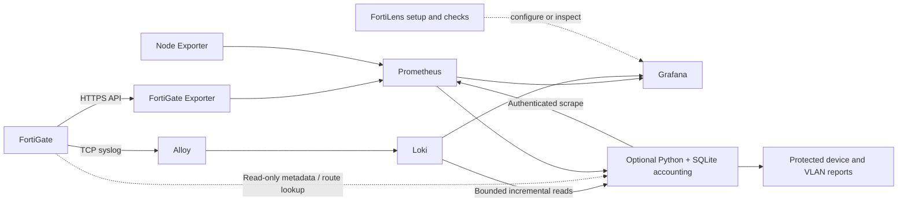

<p align="center">
  
</p>

<p align="center">
  <a href="https://github.com/Rafattitas/fortilens/actions/workflows/ci.yml"></a>
  <a href="LICENSE"></a>
  
  
  
</p>

<p align="center">
  <strong>WAN performance. Device usage. Interface context. One self-hosted view.</strong><br>
  FortiGate observability built around Grafana, Prometheus, Loki, and a guided setup.
</p>

<p align="center">
  <a href="https://github.com/Rafattitas/fortilens/releases/tag/v0.2.0">Download v0.2.0</a> ·
  <a href="#get-started">Get started</a> ·
  <a href="docs/INSTALLATION.md">Installation guide</a> ·
  <a href="docs/ARCHITECTURE.md">Architecture</a> ·
  <a href="docs/ACCOUNTING.md">Accounting limits</a> ·
  <a href="CONTRIBUTING.md">Contribute</a>
</p>

## A clearer view of the network you already run

FortiLens brings FortiGate metrics and traffic logs into a practical monitoring stack. Track WAN SLA history, review recorded device usage, inspect VLAN/interface metadata, and find missing collection data without guessing that a quiet interface is down.

Designed for **one FortiGate per independent installation**: your server, your credentials, your data.

<p align="center">
  
  <br><sub>Illustrative overview with synthetic data. Actual panels and readings depend on your FortiGate, permissions, and received samples.</sub>
</p>

## What you get

| Capability | What it does |
|---|---|
| **Unified console (current source)** | One FortiLens sign-in and navigation for native Grafana monitoring and persistent reports; opt in with `init --enable-portal`. See the [console guide](docs/UNIFIED_CONSOLE.md). |
| **WAN SLA visibility** | State, latency, jitter, packet loss, observed availability, and sample coverage. |
| **A dashboard that adapts** | Chained FortiGate → VDOM → SLA → WAN selectors, with repeating interface cards. |
| **Persistent device accounting** | Directional upload/download, stable MAC endpoints and explicit unverified fallbacks; replay-safe received-log ledger. |
| **Fixed-period reports** | Today, rolling 7 days, this calendar month, custom ranges, device search, top consumers and daily/monthly history. |
| **VLAN Internet usage** | Exact VDOM/interface/parent/VLAN mapping, segment totals and drilldown; unknown mappings remain unknown. |
| **Trust evidence** | Pending counters, source-wide classifications, processing lag, missing telemetry and observed WAN coverage. |
| **Interface and VLAN review** | Reuses exporter labels, fills metadata gaps through read-only API requests, and asks you to confirm Internet interfaces. |
| **Useful readiness checks** | Distinguishes failed collection, old samples, missing logs, and authentication boundaries. |
| **Safe deployment** | Six monitoring services plus optional constrained Python/SQLite worker, reviewed upgrade/rollback and preserved dashboards. |
| **Optional alert candidates** | Paused WAN/performance/collection rules; email/Telegram environment references without changing existing notifications. |

### Get started

You need **Linux x86-64**, **Docker Compose v2**, and **Python 3.10+**. The setup utility uses only the Python standard library. These prerequisites are not installed by FortiLens.

```bash
git clone https://github.com/Rafattitas/fortilens.git
cd fortilens/portable

python3 setup.py init
python3 setup.py start
python3 setup.py doctor
```

Prefer a standalone package? Download [fortilens-v0.2.0.zip](https://github.com/Rafattitas/fortilens/releases/download/v0.2.0/fortilens-v0.2.0.zip) and [SHA256SUMS.txt](https://github.com/Rafattitas/fortilens/releases/download/v0.2.0/SHA256SUMS.txt), verify the checksum, extract the archive, and run the same three Python commands from its `forti-monitor/` directory. The release workflow tests and builds this allowlisted package from the version tag.

During setup, enter your FortiGate address, HTTPS API port, read-only API token, optional private CA, and syslog settings. Review discovered interfaces and explicitly confirm your Internet interfaces. Keep browser services on localhost for an SSH tunnel, or use a reviewed HTTPS reverse proxy for network access. Reporting credentials must not cross an untrusted plain-HTTP network.

Then configure the intended FortiGate syslog destination to send forward traffic logs to your monitoring server. The default receiver is **TCP1514 / RFC5424**. API users, permissions, and syslog settings are configured on FortiGate by your administrator; the setup utility does not change them.

Open `http://YOUR_SERVER:3001/d/forti-monitor`. Grafana login is `admin`; its password is in `local/secrets/grafana_admin_password`. When accounting is enabled, protected reports are at the configured reporting address (default `http://127.0.0.1:3002/`), with a separate password in `local/secrets/usage_admin_password`. Use the portal for fixed-period device/VLAN answers independently of Grafana’s global time range.

Interactive setup offers accounting explicitly; file-based setup can add `--enable-accounting`. Choose an explicit accounting timezone and expected FortiGate device ID. Review [installation](docs/INSTALLATION.md), [upgrades](docs/UPGRADE.md), [troubleshooting](docs/TROUBLESHOOTING.md), and [optional alerts](docs/OPTIONAL_ALERTS.md).

**Start with the [installation guide](docs/INSTALLATION.md)** for certificates, network access, interface review, and troubleshooting. No shared password or token is shipped.

## Your everyday toolbox

Run these from `portable/`:

```bash
# List SLA names/interfaces from received metrics
python3 setup.py discover

# Review interface type, role, parent, and VLAN ID
python3 setup.py interfaces

# Read existing exporter evidence without a direct device API request
python3 setup.py interfaces --metrics-only

# Machine-readable readiness; no restarts or configuration changes
python3 setup.py doctor --json

# Explicitly add one read-only FortiGate status request
python3 setup.py doctor --api-check
```

Inventory never selects WANs automatically. Missing roles, topology gaps, and conflicting evidence remain **Needs review**. A post-start interface selection creates a backed-up local dashboard candidate for review/import; it preserves edits in the running dashboard.

## How it fits together



Grafana and the protected reports bind to loopback by default; syslog uses its configured receiver address. [Read the architecture notes](docs/ARCHITECTURE.md).

## Honest signals, clear limits

- **Missing data stays missing.** Dropdown fallback choices are configuration, not measurements. No SLA series does not establish a WAN outage.
- **Usage means received-log evidence.** Valid zero deltas stay zero; unsafe cumulative candidates stay pending. Stable event identities prevent replay double counting. Missing MACs remain explicitly unverified. [Read the accounting contract](docs/ACCOUNTING_ENGINE.md).
- **Interface metadata has a scope and time.** VLAN mapping uses exact VDOM/interface keys, never subnets. Current inventory cannot establish an old VLAN assignment. FortiGate settings are never changed automatically.
- **Early access.** Clean Docker installations and controlled HTTPS/syslog fixtures have been tested. Every FortiOS release, ARM, and new real-device onboarding are not yet validated.
- **Current scope.** One FortiGate per installation. Optional alerts are paused candidates; production activation and recipient testing are explicit operator actions. Complete topology discovery and per-flow SD-WAN route attribution are not inferred.

## Built to be inspectable

The source includes automated accounting/identity/period/VLAN/WAN tests, a Linux/Windows Python matrix, and an isolated Docker acceptance pipeline. Synthetic traffic checks the full Alloy → Loki → accounting → authenticated Prometheus path, including replay and restart behavior. See [verification](docs/VERIFICATION.md) for evidence and real-device limits. Existing v0.1.0 installations use the [reviewed upgrade guide](docs/UPGRADE.md).
```bash
python3 -m unittest discover -s tests -v
python3 portable/setup.py bundle --destination dist/fortilens-single-device.zip
```

See [verification](docs/VERIFICATION.md), [security](SECURITY.md), and [third-party notices](THIRD_PARTY_NOTICES.md).

## Help shape FortiLens

Useful contributions include FortiOS compatibility reports, sanitized API fixtures, accounting edge cases, and documentation improvements. [Open a bug report](https://github.com/Rafattitas/fortilens/issues/new/choose) or read the [contribution guide](CONTRIBUTING.md).

If FortiLens helps you, a star makes it easier for other network engineers to discover the project.

Built by [Rafat Almudarres](https://github.com/Rafattitas) · [MIT licensed](LICENSE).

<sub>Independent community project. Not affiliated with or endorsed by Fortinet. FortiGate and related names belong to their respective owners.</sub>
