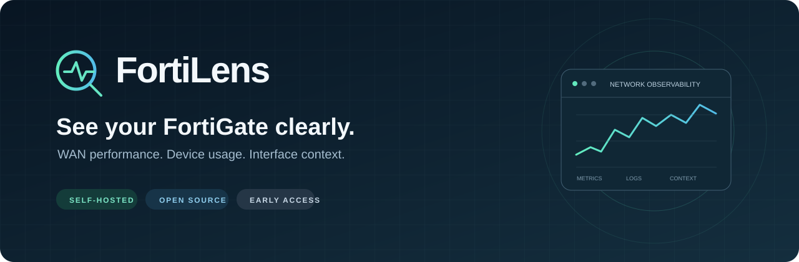
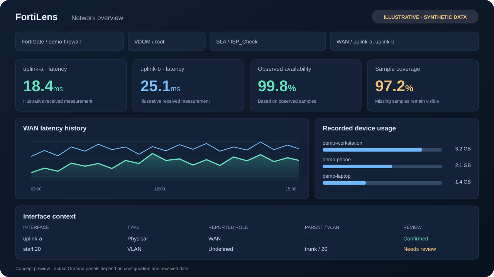
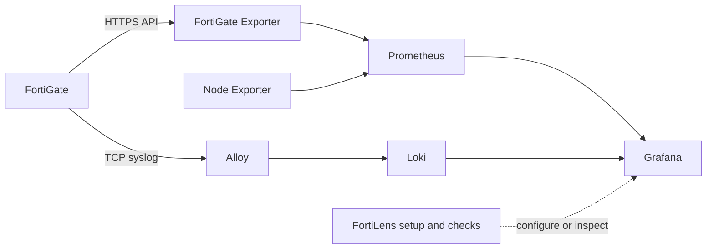

<p align="center">
  
</p>

<p align="center">
  <a href="https://github.com/Rafattitas/fortilens/actions/workflows/ci.yml"></a>
  <a href="LICENSE"></a>
  
  
  
</p>

<p align="center">
  <strong>WAN performance. Device usage. Interface context. One self-hosted view.</strong><br>
  FortiGate observability built around Grafana, Prometheus, Loki, and a guided setup.
</p>

<p align="center">
  <a href="https://github.com/Rafattitas/fortilens/releases/tag/v0.1.0">Download v0.1.0</a> ·
  <a href="#get-started">Get started</a> ·
  <a href="docs/INSTALLATION.md">Installation guide</a> ·
  <a href="docs/ARCHITECTURE.md">Architecture</a> ·
  <a href="docs/ACCOUNTING.md">Accounting limits</a> ·
  <a href="CONTRIBUTING.md">Contribute</a>
</p>

## A clearer view of the network you already run

FortiLens brings FortiGate metrics and traffic logs into a practical monitoring stack. Track WAN SLA history, review recorded device usage, inspect VLAN/interface metadata, and find missing collection data without guessing that a quiet interface is down.

Designed for **one FortiGate per independent installation**: your server, your credentials, your data.

<p align="center">
  
  <br><sub>Illustrative overview with synthetic data. Actual panels and readings depend on your FortiGate, permissions, and received samples.</sub>
</p>

## What you get

| Capability | What it does |
|---|---|
| **WAN SLA visibility** | State, latency, jitter, packet loss, observed availability, and sample coverage. |
| **A dashboard that adapts** | Chained FortiGate → VDOM → SLA → WAN selectors, with repeating interface cards. |
| **Recorded device usage** | Today, rolling 7-day, and calendar-month reports grouped by MAC/IP/name. |
| **Interface and VLAN review** | Reuses exporter labels, fills metadata gaps through read-only API requests, and asks you to confirm Internet interfaces. |
| **Useful readiness checks** | Distinguishes failed collection, old samples, missing logs, and authentication boundaries. |
| **Repeatable deployment** | Six digest-pinned Docker services, datasource provisioning, and automatic first dashboard import. |

### Get started

You need **Linux x86-64**, **Docker Compose v2**, and **Python 3.10+**. The setup utility uses only the Python standard library. These prerequisites are not installed by FortiLens.

```bash
git clone https://github.com/Rafattitas/fortilens.git
cd fortilens/portable

python3 setup.py init
python3 setup.py start
python3 setup.py doctor
```

Prefer a standalone package? Download [fortilens-v0.1.0.zip](https://github.com/Rafattitas/fortilens/releases/download/v0.1.0/fortilens-v0.1.0.zip) and [SHA256SUMS.txt](https://github.com/Rafattitas/fortilens/releases/download/v0.1.0/SHA256SUMS.txt), verify the checksum, extract the archive, and run the same three Python commands from its `forti-monitor/` directory. The release workflow tests and builds this allowlisted package from the version tag.

During setup, enter your FortiGate address, HTTPS API port, read-only API token, optional private CA, and syslog settings. Review discovered interfaces and explicitly confirm your Internet interfaces. Keep Grafana on localhost, or enter the monitoring server's LAN address for access from your network.

Then configure the intended FortiGate syslog destination to send forward traffic logs to your monitoring server. The default receiver is **TCP1514 / RFC5424**. API users, permissions, and syslog settings are configured on FortiGate by your administrator; the setup utility does not change them.

Open `http://YOUR_SERVER:3001/d/forti-monitor`. Login is `admin`; the generated password is stored privately in `local/secrets/grafana_admin_password`.

**Start with the [installation guide](docs/INSTALLATION.md)** for certificates, network access, interface review, and troubleshooting. No shared password or token is shipped.

## Your everyday toolbox

Run these from `portable/`:

```bash
# List SLA names/interfaces from received metrics
python3 setup.py discover

# Review interface type, role, parent, and VLAN ID
python3 setup.py interfaces

# Read existing exporter evidence without a direct device API request
python3 setup.py interfaces --metrics-only

# Machine-readable readiness; no restarts or configuration changes
python3 setup.py doctor --json

# Explicitly add one read-only FortiGate status request
python3 setup.py doctor --api-check
```

Inventory never selects WANs automatically. Missing roles, topology gaps, and conflicting evidence remain **Needs review**. A post-start interface selection creates a backed-up local dashboard candidate for review/import; it preserves edits in the running dashboard.

## How it fits together



Only Grafana and syslog publish host ports by default. [Read the architecture notes](docs/ARCHITECTURE.md).

## Honest signals, clear limits

- **Missing data stays missing.** Dropdown fallback choices are configuration, not measurements. No SLA series does not establish a WAN outage.
- **Usage means recorded device bytes.** It is not authenticated-user billing. Missing/duplicate logs, missing MAC fields, and session boundaries affect totals. Read [the accounting model](docs/ACCOUNTING.md) before using reports for decisions.
- **Interface role is evidence, not a guess.** VLAN is an interface type; WAN/LAN/DMZ is a reported role. Confirming a monitoring choice does not reconfigure FortiGate or change the usage query's WAN-role filter.
- **Early access.** Clean Docker installations and controlled HTTPS/syslog fixtures have been tested. Every FortiOS release, ARM, and new real-device onboarding are not yet validated.
- **Current scope.** Single device per installation. Notifications, alert-rule provisioning, a graphical setup wizard, and complete topology discovery are not included.

## Built to be inspectable

The initial release includes **35 automated tests**, a Python-version CI matrix, scoped read-only inventory, explicit interface confirmation, safe bundle allowlists, and documented evidence limits. Service images are pinned by digest; updates need compatibility review.

```bash
python3 -m unittest discover -s tests -v
python3 portable/setup.py bundle --destination dist/fortilens-single-device.zip
```

See [verification](docs/VERIFICATION.md), [security](SECURITY.md), and [third-party notices](THIRD_PARTY_NOTICES.md).

## Help shape FortiLens

Useful contributions include FortiOS compatibility reports, sanitized API fixtures, accounting edge cases, and documentation improvements. [Open a bug report](https://github.com/Rafattitas/fortilens/issues/new/choose) or read the [contribution guide](CONTRIBUTING.md).

If FortiLens helps you, a star makes it easier for other network engineers to discover the project.

Built by [Rafat Almudarres](https://github.com/Rafattitas) · [MIT licensed](LICENSE).

<sub>Independent community project. Not affiliated with or endorsed by Fortinet. FortiGate and related names belong to their respective owners.</sub>
