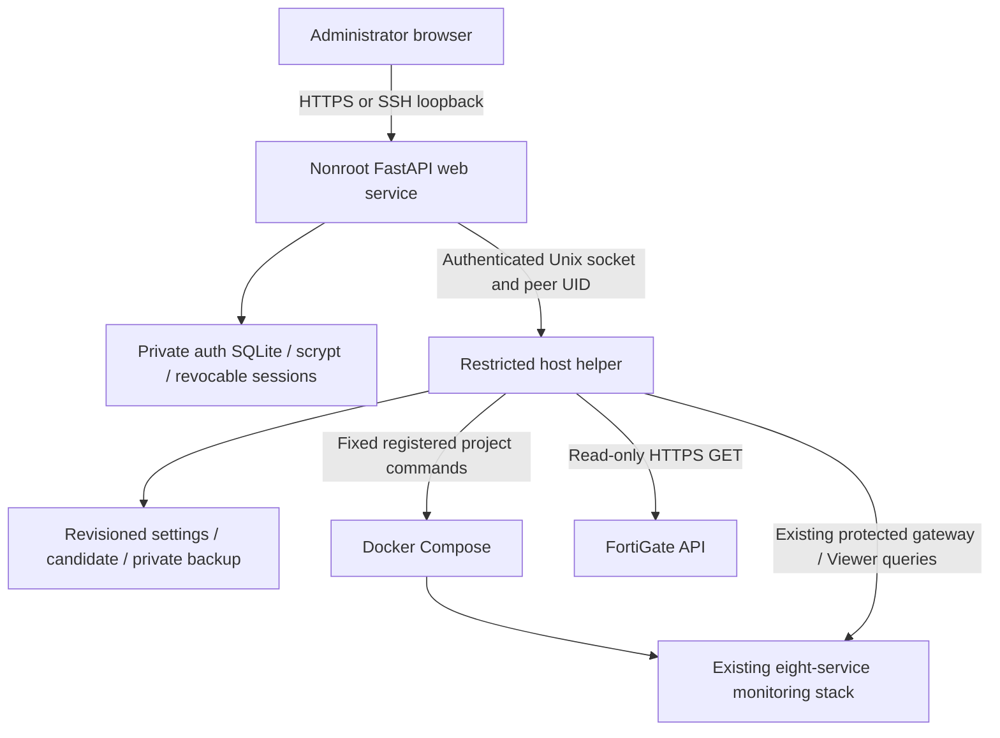

# Management architecture and compatibility review

## Repository analysis

Phase 1 adds a management layer to the existing single-FortiGate installation.
`portable/setup.py` remains the validated renderer/dashboard importer and CLI;
`interfaces.py` remains the metadata normalizer and explicit WAN selector;
`doctor.py` remains the diagnostic engine. Its new optional service-reader callback
lets the helper reuse those checks without asking the browser to execute commands.
`accounting.py`, `usage_service.py`, existing dashboard templates, query formulas,
alert rules and upgrade algorithms are not rewritten.

The installer runs once as root to create two systemd services. The web process
runs as `fortilens`, is not in the Docker group, cannot access the Docker socket,
control directory or monitoring root, and can write only its auth directory.
It remains separate from the Compose stack. The helper has host privileges but
accepts only fixed operation names and validated data on a local Unix socket;
Linux peer credentials and a private random key are both required. Its root-owned
registry fixes the installation, Compose file, project name and paths. Neither
browser nor web service can submit command lines, images, root paths or projects.
Docker/Buildx client state uses the helper's private control directory so the
service does not need write access to `/root`. Only the local Docker engine is
supported; private image-registry authentication requires a reviewed host-side
setup of that separate client state.
Installer and container builds use a fixed source allowlist. Generated site files,
untracked local installs, exports and secrets are never copied into application
code or build contexts.

## Transaction and restart boundary

Settings and write-only credentials are staged privately with a revision. A
candidate records input/output hashes, modes/owners and previous settings. Compose
is checked before activation. Apply checks the revision, credentials and hashes
again, backs up old files, installs files by atomic rename, recreates enabled
services, checks readiness and runs doctor. It never uses `down`, `rm`, `prune` or
volume deletion. Only disabled registered collectors are stopped. Recreating a
file bind ensures containers see the new inode; the gateway is recreated with
Grafana because they share a network namespace.

A single deployment lock and one worker serialize state operations. Failed or
interrupted jobs remain visible. File rollback is conservative and hash guarded;
it is not an application database backup/restore. Persistent Loki/Prometheus/
Grafana/accounting volumes are retained. An accounting source contract is written
before first worker startup and remains even after a failed first run.

## Authentication boundaries

The management account is separate from native Grafana/report passwords.
Management cookies contain opaque random IDs; only hashes are stored server-side.
Sessions expire after eight hours and are revoked on password change/recovery.
Writes require CSRF and the trusted origin; no cross-origin CORS grant exists.
Bootstrap/login attempts are rate limited. Static assets are local, with no CDN.

The read-only console bridge authenticates server-side to an already configured
unified gateway. That gateway still enforces its read-only native Grafana Viewer
boundary, allowed resource/query routes and report authentication. Native
monitoring keeps its configured `/grafana/` mount on the
management origin; reports use `/console/`. Preserving the native mount avoids
rewriting runtime router settings, plugin identifiers or external documentation.
Both mounts require the management session and the same query/write boundaries.
Service cookies and raw passwords never cross into the browser. Upstream Set-Cookie is discarded,
redirects are restricted, and framing is same-origin only. Native admin endpoints
are not a management-login bypass. Grafana Live WebSockets remain unsupported;
ordinary queries and refresh use HTTP. Do not expose either internal service on
an untrusted HTTP network.

## Compatibility risks and deliberate limits

| Area | Safe behavior / limitation |
|---|---|
| Existing volume identity | Exact Compose project required for adoption; never inferred from a display name. |
| Existing source scope | No change to accounting VDOM/timezone/serial after a contract exists. No automatic DB migration. |
| Existing dashboards | Existing installation Apply never imports/overwrites a dashboard or datasource provisioning file. |
| Existing secrets | General edits preserve actual files; replacement is an explicit write-only action. |
| Existing config | Merge supported target/interval/retention/syslog fields; preserve unrelated images, mounts, flags and alerts. Custom/ambiguous layouts require host review. |
| Retention | Reductions refused in the web UI; increases do not restore data or guarantee capacity. |
| Collector toggles | WAN/SLA/interfaces share an exporter. Native saved panels are retained; accounting off stops its report backend. |
| Fresh service images | Built accounting/gateway image tags are scoped to the registered project to avoid cross-install tag collisions. |
| Older auth layout | Keep native service sign-ins if no unified gateway exists; no silent auth migration. |
| Docker unavailable | Web/auth/Settings remain up; operations report helper/engine failures. |
| Missing source | Unknown coverage and null totals stay unknown; no fabricated bandwidth/WAN evidence. |
| Installer | Ubuntu x86-64/Python3.11+/systemd only; one control plane per host. Portable CLI stays Python3.10+. |
| Versions | Bootstrap is idempotent for the same source/options. Fully automated version upgrades remain out of scope. |
| Filesystem | Configs/secrets must live under the registered root. Remote engines/unknown bind layouts need explicit migration. |
| Storage forecast | Bounded positive filesystem-growth measurements, not a complete ingestion/capacity model; inaccessible volumes remain unavailable. |

FortiGate requests are GET-only, certificate verified by default, DNS resolved once
and IP pinned with the original TLS SNI. Local/metadata/loopback destinations and
redirects are rejected. Tests use private synthetic API addresses, not a real
firewall. Source API payloads, raw customer logs, credentials and Docker output
are never returned verbatim as error messages.
