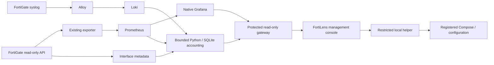

# FortiLens project context

This is the public source-maintenance guide, not a customer deployment snapshot.
Read actual code, configuration and current diagnostics before claiming live
state. Start agent work at [AGENTS.md](../AGENTS.md) and the
[FortiLens skill](../.agents/skills/fortilens-maintainer/SKILL.md).

## What the product does

One self-hosted workspace for one FortiGate: native Grafana WAN/device/interface
monitoring, received-log device/VLAN usage, WAN history/coverage, and a web setup
and settings layer. Device usage reports answer fixed periods independently of a
Grafana dashboard's global time range. A week means rolling 168 hours; a month means
the accounting timezone's calendar month. Internet state, physical link and
destination-specific route evidence are separate observations.

## Source map

| Location | Responsibility |
|---|---|
| `management/app.py`, `auth.py` | Independent FastAPI API/UI, bootstrap, sessions, CSRF and admin authentication. |
| `management/configuration.py`, `models.py` | Validated settings, optimistic revisions, candidates, file fingerprints and configuration-only recovery. |
| `management/helper.py`, `runtime.py` | Peer-UID/key authenticated Unix socket, fixed local engine operations, readiness, diagnostics and read-only console bridge. |
| `management/install.py`, `install.sh` | Ubuntu/systemd bootstrap, explicit adoption and reviewed source-file allowlist. |
| `management/static/` | English responsive setup, permanent settings, progress and diagnostics; no CDN/build toolchain. |
| `portable/setup.py`, `templates/` | Existing dependency-free setup/render/import/bundle CLI and monitoring templates. |
| `portable/interfaces.py`, `doctor.py` | Scoped metadata normalization and reusable read-only diagnostic engine. |
| `portable/accounting.py`, `usage_service.py` | Accounting ledger/summaries, source/session identity, bounded ingestion and protected report backend. |
| `portable/portal.py`, `reporting.html` | Existing protected native Grafana/report console and allowed read-only query routes. |
| `portable/wan_health.py` | Observed WAN states/history/coverage and destination-specific route evidence. |
| `portable/upgrade.py` | Existing reviewed CLI upgrade/rollback; do not run concurrently with management deployment. |
| `tests/`, `.github/workflows/ci.yml` | Unit/security/regression checks, isolated real Docker and Ubuntu installer acceptance. |

## Deployment identities and defaults

The full fresh setup normally has eight Compose services: exporter, Prometheus,
Grafana, Loki, Alloy, Node Exporter, accounting worker and monitoring gateway.
Older/opt-out installations can have fewer. Management adds two independent
systemd services, `fortilens-web` and `fortilens-helper`; these are not additional
Compose containers.

Defaults, not assumptions about a company: management loopback port 3030, native Grafana
3001, protected gateway/reports loopback port 3002, syslog TCP 1514 / RFC5424. LAN management
requires trusted HTTPS. There is no default management password; first admin uses
a one-time token. Grafana/report credentials are separate server-side service
credentials. Existing auth layouts are not silently migrated.

The installer defaults to `/opt/fortilens` for application code/venv,
`/var/lib/fortilens/web` for private auth state, `control` for helper state/candidates,
and `/etc/fortilens/registry.json` for the fixed installation/project/Compose/UID.
An adopted stack may use `site.json` or `.fortilens/site.json`. Read the registry
and actual container labels/mounts; never substitute a template project or UID.

Use [WEB_SETUP.md](WEB_SETUP.md) for installation/adoption/HTTPS/recovery,
[MANAGEMENT_ARCHITECTURE.md](MANAGEMENT_ARCHITECTURE.md) for trust boundaries, and
[UPGRADE.md](UPGRADE.md) for the separate CLI path. The published v0.2.0 standalone
ZIP predates web management; management requires the current source checkout.

## Invariants and practical limits

- Accounting uses its existing source/session identities and frozen exact VLAN
  metadata. An IP/name alone is not a permanent physical-device identity. No new
  algorithm should be inferred from a UI request.
- Missing raw records, stale metadata and collection gaps cannot be reconstructed
  by a successful deployment. Reports must expose those limits and null totals.
- Accounting VDOM/timezone/expected source-ID changes need a migration; retention
  reductions need a data-preservation review. Rollback restores files, not history
  already deleted or incompatible database migrations.
- Individual WAN/SLA/interface views share the existing exporter; all must be off
  to stop it. Native saved dashboards are preserved. Worker-off keeps data but
  prevents live report queries until re-enabled.
- The gateway supports ordinary native queries/refresh, not Grafana Live WebSocket
  streaming. The helper supports one registered local installation, not remote
  Docker engines or arbitrary custom Compose layouts.
- OS package installation is an explicit installer option. Source upgrades are
  reviewed host operations, not an automatic bootstrap side effect.

## Verification and continuation

See [QA.md](QA.md), [MANAGEMENT_VERIFICATION.md](MANAGEMENT_VERIFICATION.md) and
[VERIFICATION.md](VERIFICATION.md). Distinguish unit fixtures, isolated real
service checks, live deployment checks and real firewall numeric evidence. Use
the CI result for the actual head being released; old passing runs do not validate
a new commit. Record unsupported cases and current source availability instead
of asserting universal FortiOS compatibility, billing accuracy or capacity.

Future work should follow the current user's request. Real-device source
completeness, source identity, packet-time allocation and production capacity need
site-specific evidence. Alert candidates remain opt-in; multi-device/tenant and
new analytics are not implied by maintenance or setup work.
