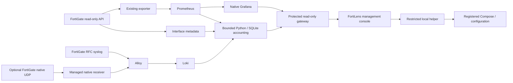

# FortiLens project context

This is the public source-maintenance guide, not a customer deployment snapshot.
Read actual code, configuration and current diagnostics before claiming live
state. Start agent work at [AGENTS.md](../AGENTS.md) and the
[FortiLens skill](../.agents/skills/fortilens-maintainer/SKILL.md).

## What the product does

One self-hosted workspace for one FortiGate: native Grafana WAN/device/interface
monitoring, received-log device/VLAN usage, WAN history/coverage, and a web setup
and settings layer. Device usage reports answer fixed periods independently of a
Grafana dashboard's global time range. A week means rolling 168 hours; a month means
the accounting timezone's calendar month. Internet state, physical link and
destination-specific route evidence are separate observations.

## Source map

| Location | Responsibility |
|---|---|
| `management/app.py`, `auth.py` | Independent FastAPI API/UI, bootstrap, sessions, CSRF and admin authentication. |
| `management/configuration.py`, `models.py` | Validated settings, optimistic revisions, candidates, file fingerprints and configuration-only recovery. |
| `management/helper.py`, `runtime.py` | Peer-UID/key authenticated Unix socket, fixed local engine operations, readiness, diagnostics and read-only console bridge. |
| `management/install.py`, `install.sh` | Ubuntu/systemd bootstrap, explicit adoption and reviewed source-file allowlist. |
| `management/static/` | English responsive setup, permanent settings, progress and diagnostics; no CDN/build toolchain. |
| `portable/setup.py`, `templates/` | Existing dependency-free setup/render/import/bundle CLI and monitoring templates. |
| `portable/interfaces.py`, `doctor.py` | Scoped metadata normalization and reusable read-only diagnostic engine. |
| `portable/syslog_receiver.py`, `templates/Dockerfile.syslog` | Explicit native/default UDP profile: bounded normalization to internal RFC5424/TCP, source-filter and transport counters; no storage/completeness certification. |
| `portable/accounting.py`, `usage_service.py` | Accounting ledger/summaries, source/session identity, bounded ingestion and protected report backend. |
| `portable/portal.py`, `reporting.html` | Existing protected native Grafana/report console and allowed read-only query routes. |
| `portable/wan_health.py` | Observed WAN states/history/coverage and destination-specific route evidence. |
| `portable/upgrade.py` | Existing reviewed CLI upgrade/rollback; do not run concurrently with management deployment. |
| `tests/`, `.github/workflows/ci.yml` | Unit/security/regression checks, isolated real Docker and Ubuntu installer acceptance. |
| `tools/check_repository.py`, `pyproject.toml`, `requirements-dev.txt` | Development-only grammar/link/YAML/source checks, narrow Ruff rules and measured branch coverage. No production dependencies or package/import migration. |
| `tools/release.py`, `.github/workflows/release.yml` | Reproducible allowlisted full source and compatible portable distributions, checksums and extracted-artifact acceptance; publication remains an explicit maintainer action. |

## Deployment identities and defaults

The full fresh setup normally has eight Compose services: exporter, Prometheus,
Grafana, Loki, Alloy, Node Exporter, accounting worker and monitoring gateway.
Older/opt-out installations can have fewer. Management adds two independent
systemd services, `fortilens-web` and `fortilens-helper`; these are not additional
Compose containers.

Selecting native `fortigate` format adds a ninth service, `fortilens-syslog`,
when the other eight are enabled. It replaces only the public syslog leg with
the configured UDP binding; Alloy remains internal RFC5424/TCP. It is an explicit
profile, not a changed default or an automatically installed host service.

The explicit `syslog_network: host` variant supports rootful Linux Docker Engine
when UDP publishing hides the original sender. Only the nonroot native receiver
shares the host network namespace, with `NET_BIND_SERVICE` as its sole capability.
It binds the configured UDP port directly and uses loopback TCP on that port for
Alloy and the next port for health. Bridge remains the default. The host profile
needs an actual FortiGate IPv4 address and omits the bridge-only receiver
Prometheus scrape; diagnostics and local metrics remain available. See the
[native reception guide](SYSLOG_NATIVE_UDP.md) for security tradeoffs and migration.

Defaults, not assumptions about a company: management loopback port 3030, native Grafana
3001, protected gateway/reports loopback port 3002, syslog TCP 1514 / RFC5424. LAN management
requires trusted HTTPS. There is no default management password; first admin uses
a one-time token. Grafana/report credentials are separate server-side service
credentials. Existing auth layouts are not silently migrated.

SLA names are installation choices. Blank selection stays supported and asks for
review in diagnostics instead of treating any observed SLA as the selected one.
`google` is not a public default. Read fresh labels in the intended VDOM and
explicitly choose/apply a check; do not change WAN algorithms to reconcile
different destination-specific results.

The installer defaults to `/opt/fortilens` for application code/venv,
`/var/lib/fortilens/web` for private auth state, `control` for helper state/candidates,
and `/etc/fortilens/registry.json` for the fixed installation/project/Compose/UID.
An adopted stack may use `site.json` or `.fortilens/site.json`. Read the registry
and actual container labels/mounts; never substitute a template project or UID.

Use [WEB_SETUP.md](WEB_SETUP.md) for installation/adoption/HTTPS/recovery,
[MANAGEMENT_ARCHITECTURE.md](MANAGEMENT_ARCHITECTURE.md) for trust boundaries, and
[UPGRADE.md](UPGRADE.md) for the separate CLI path. The published v0.2.0 standalone
ZIP predates web management; management requires current source from a reviewed
checkout or a validated full distribution. The additive full distribution is
prepared by [RELEASING.md](RELEASING.md); repository cleanup does not publish it
or replace existing release assets.

## Invariants and practical limits

- Accounting uses its existing source/session identities and frozen exact VLAN
  metadata. An IP/name alone is not a permanent physical-device identity. No new
  algorithm should be inferred from a UI request.
- Missing raw records, stale metadata and collection gaps cannot be reconstructed
  by a successful deployment. Reports must expose those limits and null totals.
- Accounting VDOM/timezone/expected source-ID changes need a migration; retention
  reductions need a data-preservation review. Rollback restores files, not history
  already deleted or incompatible database migrations.
- Individual WAN/SLA/interface views share the existing exporter; all must be off
  to stop it. Native saved dashboards are preserved. Worker-off keeps data but
  prevents live report queries until re-enabled.
- The gateway supports ordinary native queries/refresh, not Grafana Live WebSocket
  streaming. The helper supports one registered local installation, not remote
  Docker engines or arbitrary custom Compose layouts.
- OS package installation is an explicit installer option. Source upgrades are
  reviewed host operations, not an automatic bootstrap side effect.

## Verification and continuation

Managed Device usage and Reports are distinct presentations of the same received
accounting evidence. Device usage focuses on the searchable/paginated endpoint
table and per-device history. Reports shows period totals, a top-five consumer
summary, relative segment distribution and the VLAN table, without duplicating
the full device table. Both retain period/search/segment filters and null/unknown
evidence semantics. Standalone legacy overview links retain their combined view.

The console uses a continuous dark workspace, divided summary strips, viewport-
filling native monitoring/reports and an accessible compact-screen drawer. Read
[UI_DESIGN.md](UI_DESIGN.md) before changing the shell or hosted report styling.
Preserve the native `/grafana/` mount and scope report presentation to `/console/`;
do not replace saved Grafana panels or reintroduce nested framed surfaces.

See [QA.md](QA.md), [MANAGEMENT_VERIFICATION.md](MANAGEMENT_VERIFICATION.md) and
[VERIFICATION.md](VERIFICATION.md). Distinguish unit fixtures, isolated real
service checks, live deployment checks and real firewall numeric evidence. Use
the CI result for the actual head being released; old passing runs do not validate
a new commit. Record unsupported cases and current source availability instead
of asserting universal FortiOS compatibility, billing accuracy or capacity.

Start repository maintenance at the [documentation index](README.md),
[repository audit](REPOSITORY_AUDIT.md) and [cleanup validation](CLEANUP_VALIDATION.md).
The runtime layout, installer source allowlist, Docker contexts, accounting/auth
logic and CLI stay in place; [MAINTAINABILITY.md](MAINTAINABILITY.md) records
prerequisites for separately reviewed refactors. New development tools are
formatted independently of existing runtime source. The roadmap marks
unimplemented analytics/reporting extensions as planned.

Runtime failures are documented in [ERROR_HANDLING.md](ERROR_HANDLING.md).
HTTP/helper/CLI/browser boundaries return bounded diagnostics without raw
exception content. Corrupt configuration remains for host review; partial
deployment writes use the existing recovery marker, and queue failures release
the operation lock. Failed ingestion never advances a checkpoint. A timed-out
mutation has an unknown outcome: inspect actual settings/job status before
retrying. The helper's bounded latest-job cache is not durable recovery storage.
No runtime module moves, new third-party Python dependencies, database schemas,
renamed existing Compose identities, accounting/WAN formulas or authentication
policies accompany these changes.

Deployment success leaves the main progress surface and remains in collapsed
history; running operations restore tracking, failures require acknowledgement
and recorded job IDs remain usable for older details. Optional requested/applied
revision fields preserve old journals. Settings expose discovery readiness;
monitoring diagnostics use the applied connection rather than an unapplied draft.
Pending CA operations resolve before candidate validation. TLS-off with an active
retained CA remains a typed conflict, never a silent trust-policy change.
Selected optional exporter capabilities are reported separately; successful Loki
polling does not establish delivery. Pinning requires an independently trusted
reference and coordinated coverage of all clients; no partial pinning option is
advertised. See [repair verification](REPAIR_VERIFICATION.md).

The settings editor keeps a draft value snapshot and records intentional edits
only from visible, editable controls. Saving, testing and preparing serialize
that snapshot rather than scanning hidden form values. This prevents browser
autofill from persisting an unvisited device identity or API-token input.
The masked API-token field has a separate form association from configuration;
autocomplete hints supplement the draft boundary. Serial checks and locked
accounting source contracts remain enforced by the helper.

The [native UDP guide](SYSLOG_NATIVE_UDP.md) describes the explicit managed
`fortigate`/UDP profile and preserves the separate legacy rsyslog alternative.
The managed standard-library receiver accepts bounded native logfmt messages,
retains the source body/eventtime, wraps RFC5424 and forwards to internal Alloy
with a bounded memory queue. Its IPv4 source filter resolves the configured API
host at startup; it is not authentication. Health, TCP handoff, Loki storage and
accounting delivery remain separate evidence. UDP/queue/restart loss is possible;
no complete-capture or reconstructed-history claim follows. The old rsyslog host
service remains outside helper management and must not compete for a binding.

Management optional exporter exclusions are explicit and narrowly limited to
`Log/Fortianalyzer/Status`, `System/Interface/Transceivers` and `System/SensorInfo`.
Unchanged/null policy preserves existing coverage, including legacy selections;
an explicit empty list removes only these three exclusions while retaining
custom include/exclude rules, other targets and the token. Successful selected
probes do not establish availability of omitted capabilities.
TLS verification remains owner-controlled and an explicit temporary TLS-off
deployment stays a warning; no untrusted certificate is silently pinned.

Monitoring launch paths use the applied SLA, including the inner reporting
console's Monitoring link. Management also supplies a server-time capability and
timestamp. When the browser differs by more than one minute and at most one day,
the console warns and requests a page-local Grafana clock adapter before native
scripts initialize. This covers Grafana's independent panel-relative periods as
well as the dashboard range. The OS and parent-page clocks, explicit dates,
stored records, saved dashboards, queries and selectors are not rewritten.
Missing/unsupported clock metadata preserves legacy behavior with a warning when
skew is known. Direct legacy portal access still requires choosing its actual SLA.

Future work should follow the current user's request. Real-device source
completeness, source identity, packet-time allocation and production capacity need
site-specific evidence. Alert candidates remain opt-in; multi-device/tenant and
new analytics are not implied by maintenance or setup work.
